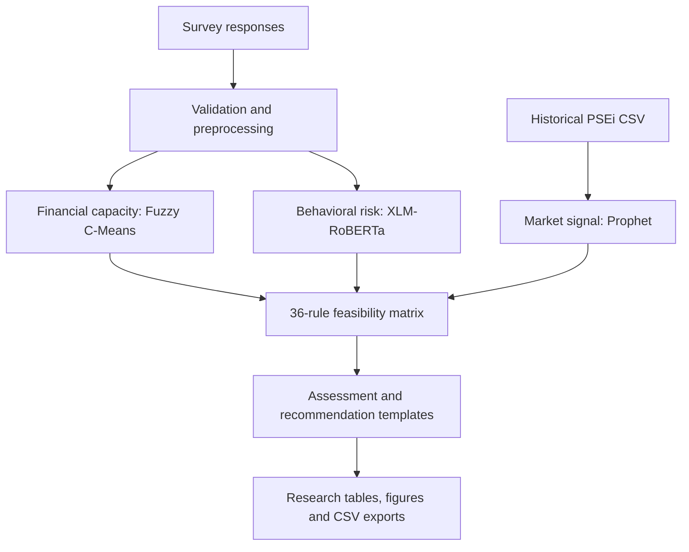

# AI-Based Financial Advisory Model for Digital Micro-Investments

**Academic research prototype focused on middle-income Filipino investors.**

This repository contains the **Google Colab implementation** of an AI-assisted financial advisory framework. The prototype processes survey responses and historical Philippine Stock Exchange Index (PSEi) data, derives financial-capacity and behavioral-risk profiles, generates a market forecast, and combines these inputs through an explicit rule-based investment feasibility assessment.

> **Research and educational use only.** This is an experimental decision-support prototype, **not a deployed financial advisory service** or a validated source of personal investment advice. Forecasts and recommendation templates should not be used for real financial decisions.

## Research team

**Thesis title:** *An AI-Based Financial Advisory Model Framework for Digital Micro-Investments among Mid-Income Filipinos*  
**Researchers:** Julienne Dana T. Felipe, Michael Mario P. Kambayashi, and Dylan Hope A. Salazar  
**Institution:** Mapúa University — Makati, Bachelor of Science in Computer Science
**Research Paper** [`An AI-Based Financial Advisory Model Framework`]([notebooks/financial_advisory_prototype.ipynb](https://michael-kambayashi.github.io/papers/financial-advisory.pdf))

This repository showcases the computational prototype from a collaborative university thesis. The full manuscript is **not distributed in this repository yet** pending coauthor approval, public-release review of respondent quotations, and confirmation of any university requirements.

## Project at a glance

| Area | Implementation |
| --- | --- |
| Language and environment | Python, Google Colab / Jupyter Notebook |
| Data preparation | pandas, NumPy, custom cleaning and validation |
| Financial capacity | **Fuzzy C-Means (FCM)** using `scikit-fuzzy` |
| Behavioral analysis | **XLM-RoBERTa** zero-shot text classification via Hugging Face `transformers` |
| Market forecasting | **Prophet**, using historical PSEi price data |
| Decision support | **36-rule feasibility matrix** combining three inputs |
| Evaluation | Cluster metrics, forecasting backtesting, researcher-consensus classification comparison, qualitative review workflow |

## System workflow



The modules perform different tasks:

1. **Survey preprocessing.** Filters respondents by the study's target income range (PHP 24,060–144,360 per month), cleans financial and open-ended answers, and handles incomplete records.
2. **Financial capacity (FCM).** Uses dependents, gross income, expenses, and net savings to group respondents into three relative capacity categories: *Low*, *Medium*, and *High Financial Capacity*. Monetary features are winsorized, log-transformed, and standardized before clustering.
3. **Behavioral risk (XLM-RoBERTa).** Applies the pretrained `joeddav/xlm-roberta-large-xnli` zero-shot classifier to two open-ended questions about investment preferences and responses to losses. The prototype combines their classifications into *Low Risk Tolerance*, *Neutral*, or *High Risk Tolerance* via explicit rules. **This is not a model trained from scratch on the study's survey data.**
4. **Market signals (Prophet).** Fits a time-series forecast to manually supplied historical PSEi closing index data, calculates a **30-business-day** forecast, and categorizes the result as *Positive*, *Neutral*, *Negative*, or *Volatile* (the last label reflects forecast uncertainty in this code).
5. **Rule-based assessment.** Integrates **3 financial capacity × 3 behavioral risk × 4 market signal** categories into a **36-combination rule table**, followed by explanatory recommendation templates.
6. **Evaluation and exports.** Implements FCM Fuzzy Partition Coefficient and silhouette scoring; Prophet cross-validation metrics; researcher-consensus comparisons for behavioral classifications; and a qualitative recommendation-review workflow. Saves output tables and figures locally when executed.

## Results reported in the thesis manuscript

The figures below are **reported results from the group research manuscript**, not independently reproduced by running the public notebook. The original datasets and completed review sheets are not included in this repository.

| Component | Reported result | Important qualification |
| --- | --- | --- |
| Survey screening | 91 original responses; 82 passed self-reported income screening; 69 passed validated income screening; 68 respondents were used in the integrated analysis | Small purposive sample; not representative of all mid-income Filipinos |
| Fuzzy C-Means | Fuzzy Partition Coefficient **0.7575**; Silhouette Score **0.2935** | Cluster memberships were relatively concentrated, but dominant clusters had considerable geometric overlap |
| XLM-RoBERTa | **84% accuracy** (21 of 25 profiles agreeing with researcher-consensus labels); weighted F1-score **0.8362** | Small researcher-labeled validation sample, including only 2 high-risk profiles |
| Prophet | MAE **331.65**, RMSE **366.14** PSEi index points; MAPE **5.16%** | Cross-validation used a 30-calendar-day horizon, unlike the 30-business-day projected forecast; no baseline model was evaluated |
| Integrated decision rules | All 36 behavior × capacity × market combinations defined; 8 combinations observed in the final prototype run | Reported assessments are heuristic decision-support outputs, not evidence of profitable investments |

The manuscript also reports a limited qualitative review of two example recommendations by 15 participants. These are prototype validation findings, **not evidence of investment safety, profitability, or production readiness**.

## Repository structure

```text
AI-Financial-Advisory-Model/
├── README.md
├── requirements.txt
├── .gitignore
├── notebooks/
│   └── financial_advisory_prototype.ipynb
├── src/
│   └── final_thesis_prototype_colab_export.py
└── docs/
    └── DATA_REQUIREMENTS.md
```

**Start with `notebooks/financial_advisory_prototype.ipynb`.** The notebook is reconstructed from the provided Colab-exported Python source, with its explanatory text separated into Markdown cells. The source export is included for reference; it still contains notebook-specific commands such as `!pip` and Colab upload/download calls, so **do not expect `python src/final_thesis_prototype_colab_export.py` to work as a standalone script**.

## How to explore the prototype in Google Colab

1. Download or open [`notebooks/financial_advisory_prototype.ipynb`](notebooks/financial_advisory_prototype.ipynb) in **Google Colab**.
2. Run the initial setup cell to install the Python dependencies (a Colab runtime and internet access are needed to download the pretrained NLP model).
3. When prompted, supply a **permitted, appropriately de-identified survey CSV** with the expected original survey column names.
4. When prompted, supply historical **PSEi CSV** data with `Date` and `Close` (or `Price`) columns.
5. Execute cells sequentially. The evaluation sections later prompt for a completed **researcher-consensus annotation CSV** and a **qualitative evaluation CSV**; these are distinct from the original survey and may require human reviewers.
6. Review generated tables and images in `output_results/`. Do not commit respondent-level outputs, annotations, or other confidential material.

See [data requirements](docs/DATA_REQUIREMENTS.md) before running. **Input datasets and completed evaluation worksheets are not included**, so the complete research run cannot be reproduced from this repository alone.

### Installation notes

The notebook was originally developed for Google Colab. Its installation cell and `requirements.txt` list the libraries imported by the prototype. The use of Hugging Face XLM-RoBERTa can require substantial memory and model download time; a Colab GPU runtime may be helpful but is not assumed.

```bash
pip install -r requirements.txt
```

Installing the requirements locally is **not sufficient** to run the notebook as a normal Python script: the implementation uses Colab-specific `files.upload()` and `files.download()` interactions and expects the original survey fields.

## Data and research ethics

- **No respondent-level financial or behavioral survey data is included.** Keep participants' financial details, written answers, and identifiers private unless the research consent and institutional rules explicitly permit release.
- The supplied Python source does **not** include the original research CSVs or recorded final run outputs. The **Results reported in the thesis manuscript** section cites figures from the provided research paper; those figures were not independently recomputed from the published code.
- `output_results/`, downloaded exports, and local datasets are excluded by `.gitignore`; check all files manually before every public commit.
- The script contains configuration choices and heuristic rules specific to this academic prototype. The resulting categories and recommendation templates are not a substitute for professional suitability assessments.
- The paper identifies participants using respondent labels, but some results include **verbatim responses linked to respondent numbers**. Pseudonyms alone do not guarantee anonymity; review those quotes and the original research-consent terms before releasing the manuscript.
- The coauthors are credited above. Confirm their consent and any university publication requirements before publicly distributing the jointly authored thesis PDF.
- Before publishing the revised manuscript, remove or audit external notebook links and verify that no saved cell outputs expose private respondent data or unintended access to research materials.

## Limitations

- Research prototype rather than a production application; there is no persistent web application, API, or live financial-data integration in this repository.
- Market forecasts depend on the historical CSV supplied at execution time; they do not represent guaranteed future performance.
- The zero-shot NLP labels are derived from a pretrained model and manually designed candidate descriptions. Human validation is needed before making strong classification claims.
- The rule-based feasibility outputs depend on design assumptions and are not independently validated financial recommendations.
- **Public-release notebook and files are structurally checked, not end-to-end re-executed.** Raw data and completed annotation files were not provided.

## Suggested next steps

- Add a **redacted or synthetic sample dataset** matching the expected schema (clearly label it synthetic).
- Add sanitized example figures and results after verifying publication permission and privacy.
- Pin dependencies and reorganize the notebook into reusable modules if you plan to maintain it.
- Add a link to the complete research manuscript once the coauthors and university permit public release.

---

**Project type:** University academic research and prototype development.  
**Status:** Source and notebook demonstration; not a financial product.  
